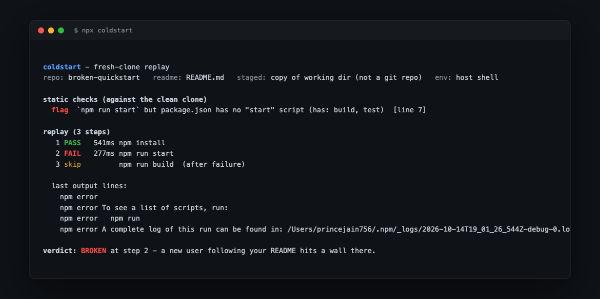

# coldstart

**Does your repo pass a fresh clone?**

Every README makes a promise: run these commands and it works. coldstart
checks the promise. It clones your repo into a clean temp dir, runs static
checks against what actually ships, then replays the commands your README
tells a stranger to run.

```bash
npx coldstart-cli              # replay the repo in the current directory
npx coldstart-cli <path>       # a local repo
npx coldstart-cli <git-url>    # or straight from GitHub
```



## What it catches

- `npm run build` when package.json has no `build` script (flagged before
  anything runs)
- `./scripts/setup.sh` that the README references but the repo forgot to ship
- `pip install -r requirements.txt` with no requirements.txt committed
- README says `npm` but the lockfile says `pnpm`
- Steps that need `MY_API_KEY` but no `.env.example` to tell the user what
  to set
- Commands that only work because *your* machine happens to have the tool

## What it does

1. **Clones the committed state** into a temp dir, so `node_modules`,
   `.env`, and uncommitted files can't hide the breakage. Non-git dirs get
   copied minus the usual ignored folders.
2. **Parses the README** for shell blocks in Install / Quickstart / Usage
   sections. Pasted example output and placeholder lines get filtered out.
3. **Static checks** against the clean clone: missing scripts, missing
   referenced files, package-manager mismatches, secret env vars with no
   example file, binaries not on PATH.
4. **Replays each command** in order. `export` and `cd` steps update the
   session for later steps. Dev servers get a 15s startup window and count
   as good if they stay up. Steps needing placeholder paths (`./my-app`,
   `owner/repo`) or files the user brings (`photo.jpg`) are skipped with a
   note, not failed. `npx <the-repo's-own-package>` resolves from the
   registry, the way a real user's machine would see it.
5. **Verdict**: PASS, RUNS-with-flags, or BROKEN at the step where a new
   user hits the wall, with the last lines of real output.

Exit code is non-zero on BROKEN (and on flags in `--only-static`), so it
drops into CI. In GitHub Actions, findings land as inline annotations on
the exact README lines:

```yaml
- run: npx coldstart-cli --only-static   # fast gate, no commands executed
- run: npx coldstart-cli                 # or the full replay
# annotations appear automatically on GitHub Actions; locally: --github
```

## Options

```
--docker [image]   replay inside one clean container per run (auto-detects
                   node, python, go, rust from the repo). State persists
                   between steps: pip installs and dev servers survive
--only-static      checks only, run nothing
--keep-going       don't stop at the first failure
--json             machine-readable report
--github           emit ::error/::warning annotations (auto in Actions)
--quiet            just the verdict line
```

## Directives

HTML comments control replay without uglifying the rendered README:

````markdown
<!-- coldstart:ignore -->
```bash
terraform apply      # never replayed, shown as skipped
```

<!-- coldstart:env DATABASE_URL=postgres://localhost/test -->
```bash
npm run migrate      # runs with DATABASE_URL injected
```
````

`coldstart:daemon` before a server block marks it as backgrounded without
needing the usual dev/start naming.

## Example

`examples/broken-quickstart` ships a README that tells the user to
`npm run start` when the script is called `build`:

```
  flag  `npm run start` but package.json has no "start" script (has: build, test)

   1 PASS   507ms npm install
   2 FAIL   211ms npm run start
   3 skip         npm run build  (after failure)

verdict: BROKEN at step 2 - a new user following your README hits a wall there.
```

The static check caught it before a single command ran. The replay confirms
it with the real npm error.

## Honest limits

- **Host replay shares your env.** Tools you have installed mask missing
  prerequisites a stranger wouldn't have. `--docker` is the real clean
  room; host mode is the fast check.
- **POSIX shells only.** Commands run through `sh -c`; Windows READMEs with
  PowerShell blocks are detected but not replayed.
- **It replays what the README literally says.** A quickstart that works
  but is badly explained still passes; the docs-audit part is limited to
  the static checks.
- **Placeholder detection is heuristic.** `./my-app` and `owner/repo` are
  treated as examples and skipped; if your README genuinely requires a
  path that is missing, the static flag is what catches it.
- Commands run as you, on your machine. `curl | bash` steps get a warning
  in the report; use `--docker` if the README is not yours.

## Install

```bash
npm i -g coldstart-cli     # or just npx coldstart-cli
```

MIT
